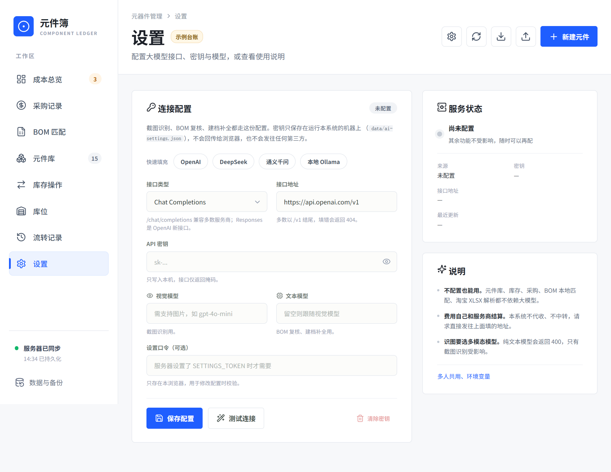

# 元件簿

给自己用的元器件台账：**元件库、库存流转、采购记录、BOM 匹配**。手机和电脑都能开，数据就存在你自己机器上的一个 JSON 文件里。

大模型（截图识别、BOM 复核）是**可选项**：不配置也能用全部核心功能；要用的话，自己填接口地址和密钥，请求从你的机器直接发出去。

## 下载

| 平台 | 文件 |
| --- | --- |
| Windows 10/11 | [component-ledger-0.1.6-win64.zip](https://github.com/H19973456501/component-ledger/releases/download/v0.1.6/component-ledger-0.1.6-win64.zip) · 0.6 MB |
| macOS / Linux | [component-ledger-0.1.6.tar.gz](https://github.com/H19973456501/component-ledger/releases/download/v0.1.6/component-ledger-0.1.6.tar.gz) · 0.6 MB |

全部版本见 **[Releases](https://github.com/H19973456501/component-ledger/releases)**。

需要 Node.js 18 或更高版本（<https://nodejs.org/>，装完重启一次电脑）。

## 怎么装

**压缩包里的 `1-使用说明.txt` 是完整的分步操作手册**（装环境 → 解压 → 启动 → 录入 → 采购 → BOM → 大模型 → 备份 → 手机访问 → 常见问题），照着编号做就行。

最简流程：

1. 装 Node.js 18+（<https://nodejs.org/>，一路 Next，装完重启）
2. 解压到 D 盘或桌面（别放 C 盘根目录、别放 Program Files）
3. 双击 **`2-启动.bat`**（macOS / Linux：`chmod +x 2-启动.sh` 后 `./2-启动.sh`）

浏览器会自动打开 <http://localhost:5173>，关掉黑窗口就是停止。

第一次打开是**一张空台账**（不带任何示例元件），点「新建元件」开始录入。

## 装在 Linux 服务器上（实验室多人共用）

包内带 `deploy/` 目录：`sudo bash component-ledger-0.1.6/deploy/install.sh component-ledger-0.1.6`
一条命令装成 systemd 服务，开机自启、每天 22:00 自动备份、防火墙放行内网端口。
细节见包内 `deploy/README.md`。

## 它有什么

- **元件库**：分类、型号、规格、封装、厂商、库存、安全库存、位号、照片、备注
- **库存操作**：入库 / 出库 / 移库 / 损耗，每一步都留流转记录
- **采购记录**：手填或导入淘宝订单 XLSX，运费、优惠按订单分摊；确认收货自动入库
- **BOM 匹配**：粘贴或上传 BOM，先本地按型号/规格/封装模糊匹配，给出候选和置信度
- **截图识别**（可选 AI）：采购订单截图 → 商品行、数量、单价、运费
- **多端同步**：单文件台账 + 版本号乐观锁，两台设备同时改会明确报冲突，不会静默覆盖
- **手机可用**：可以「添加到主屏幕」，全屏使用

## 配置大模型（可选）

右上角**齿轮 → 设置**，填：接口类型、接口地址、API 密钥、视觉模型、文本模型，点「测试连接」确认能通再保存。

- 密钥只写在本机 `data/ai-settings.json`，界面上只显示 `sk-a******z9` 这样的掩码，不会回传明文。
- 支持 `Chat Completions`（多数服务商）和 `Responses`（OpenAI 新接口）两种协议。
- 页面上有 OpenAI / DeepSeek / 通义千问 / 本地 Ollama 的一键填充。

不配置时：「截图识别」「AI 复核」按钮不可用，其余功能不受影响。

## 数据与备份

| 内容 | 位置 |
| --- | --- |
| 台账 | `data/warehouse.json` |
| 大模型配置 | `data/ai-settings.json` |

备份 = 复制整个 `data` 文件夹；也可以在应用里「导出备份」下载 JSON。

## 常见问题

**双击闪一下就没了** → 没装 Node.js，或装了没重启。命令行跑 `node -v` 看有没有版本号。

**端口被占用** → 设环境变量 `PORT=5174` 再启动。

**手机打不开** → 同一 WiFi、防火墙放行 5173、用电脑的局域网 IP（不是 127.0.0.1）。

**识别报 401 / 404** → 密钥不对或接口地址错（多数以 `/v1` 结尾）。

**提示不支持图片** → 视觉模型填成了纯文本模型。

## 版本

当前 **0.1.6**。之后的版本都发在 [Releases](https://github.com/H19973456501/component-ledger/releases)，仓库里只放说明和截图，不放安装包。

## 许可

免费使用，**禁止转售和二次分发**，详见 [使用许可.txt](使用许可.txt)。
本软件内含开源组件，其许可见 [第三方组件许可.txt](第三方组件许可.txt)。

> 本仓库只提供可执行包，不提供源代码。